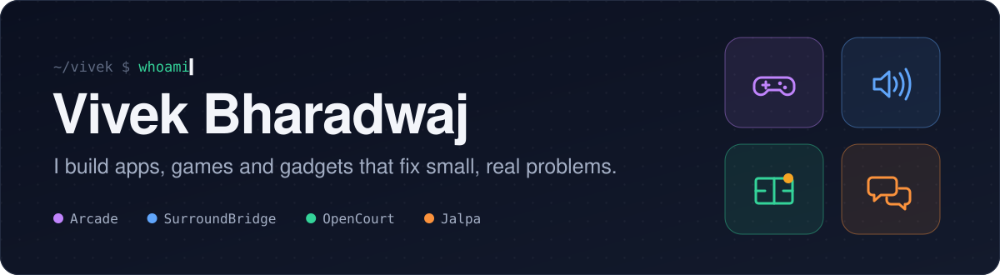
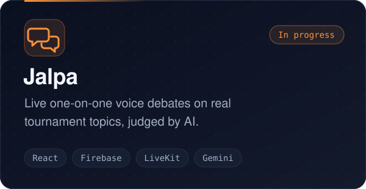
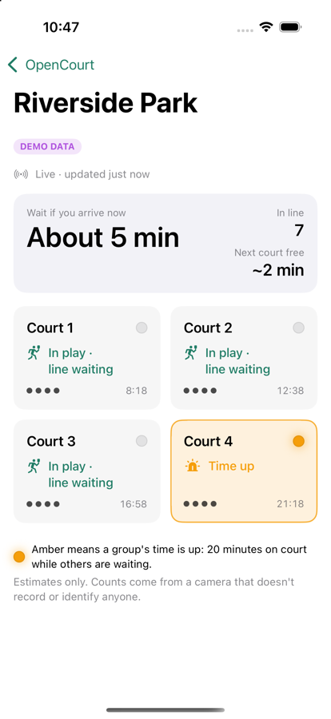
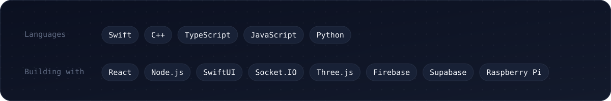

  

Hi, I'm Vivek  I'm a student at Adlai E. Stevenson High School, and I like building things that solve a problem I've actually run into. That has meant a browser arcade of party games, a Mac app that sends real surround sound to a TV live, a light that settles who's next at the pickleball courts, and an app for practicing debate. Below is what each one does and how it works.

 

  
  
  
  

 

## Arcade

**A website where friends can jump into a game together from their own phones or laptops.** Someone makes a room, shares a 4-letter code, and everyone plays live.

| Game | What you do |
|---|---|
| 🧠 **Mind Meld** | Everyone types a word at the same time. Each round you try to think of a word that connects the last ones, until the whole group says the same word. |
| ⚡ **Speed Trivia** | Up to 10 players answer the same questions at once. Faster correct answers score more. |
| 💰 **Bid Battle** | Teams bid on how many things they can name in a category (car brands, dog breeds…), then have to back it up. |
| 🗝️ **Codewords** | Two teams, a 5×5 grid of words, and a spymaster on each side giving one-word clues. |
| 🕵️ **Imposter** | Everyone gets the same secret word except the imposter, who has to bluff. Works on one shared phone or online. |
| ♟️ **Chess** | Online chess with real clocks, or pass-and-play on one screen. |
| 🏎️ **Hotlap** | A 3D time-trial racer with 12 tracks, ghost replays and millisecond timing. |

**How it works:** one Node.js server keeps every game's state and pushes updates to all players in real time with Socket.IO. All the games share the same room, matchmaking and reconnect code, so each new game only adds its own rules. Hotlap's physics run identically on every computer, so the server can replay a lap and confirm a leaderboard time is real.

▶ **[Play it live](https://arcade-1628.onrender.com)** (free hosting, so give it up to a minute to wake up) · [Code](https://github.com/Viv-411/arcade)

 

## SurroundBridge

**A macOS app that lets a Mac play true AC3 Dolby Digital 5.1 surround sound through a TV or receiver, with full control over every speaker.**

The problem: HDMI ARC and optical cables can't carry six channels of normal audio, so a Mac connected that way only plays stereo. SurroundBridge captures the Mac's sound as 5.1, applies your settings, then compresses it into Dolby Digital in real time, which those cables *can* carry.

- Per-speaker volume, delay and EQ, a master EQ, and bass sent to the subwoofer
- Receiver-style sound modes, so stereo music can fill all the speakers
- **Room & Position:** draw your room, drag yourself to your seat, and it balances the speakers for that spot

Built on top of [SoundPusher](https://codeberg.org/q-p/SoundPusher) by Daniel Vollmer. I added the audio processing engine (C++), the whole SwiftUI app, and the install scripts. · [Code](https://github.com/Viv-411/SurroundBridge)

 

## OpenCourt

**A small device that keeps public pickleball court rotations fair, plus an app that tells you how busy they are before you drive over.**

At public courts the rule is "play a game, then rotate off," but nobody likes being the person who tells a group to leave. OpenCourt puts a camera and a Raspberry Pi by the courts. It counts how many people are playing and how many are waiting, and when a group has been on for 20 minutes while others wait, an amber light turns on at their court. Nobody has to argue; you just point at the light.

<table>
<tr>
<td width="62%">

- **Sensor (Python, Raspberry Pi 5):** a YOLO vision model counts people on each court and in line. It never records video or identifies anyone; it only counts.
- **Backend (Supabase):** stores live court status and events.
- **iPhone app (SwiftUI):** shows wait times, which courts are open, and local events.

**Status:** the sensor software, backend and app all work on demo data. The next step is testing with real footage at the courts.

[Code](https://github.com/Viv-411/OpenCourt)

</td>
<td width="38%" align="center"></td>
</tr>
</table>

 

##Jalpa

**Online one-on-one voice debates, judged by AI and ranked with Elo, so you can practice debate any time without needing a partner or a judge.**

1. Pick a subject, and you're matched with someone near your rating.
2. You both get a real past tournament resolution (Lincoln-Douglas and Public Forum topics) and a side.
3. After a minute of prep, you take turns giving six timed speeches over live voice. Only the current speaker's mic is on.
4. Each speech is transcribed. At the end, an AI judge (Gemini) reads the whole debate, writes a ballot with scores and feedback, and both ratings update.

Built with React, Firebase, LiveKit for voice, and serverless functions that run the debate clock, matchmaking and judging so nobody can fake a result. · [Code](https://github.com/Viv-411/jalpa)

 

## 🧰 Toolbox

A personal website is in the works. Until then, this page is the best tour of what I'm building.

